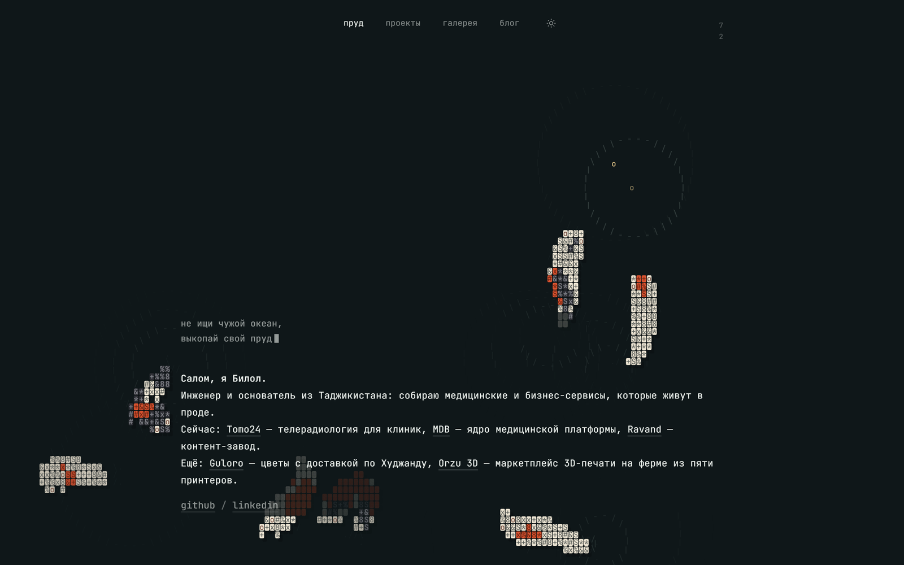
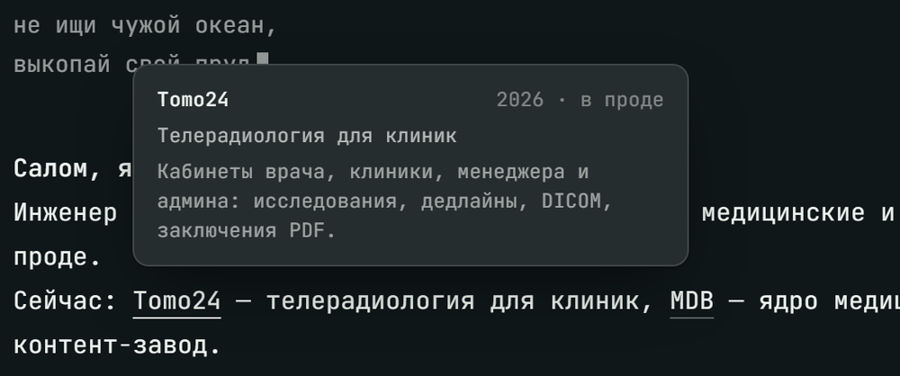
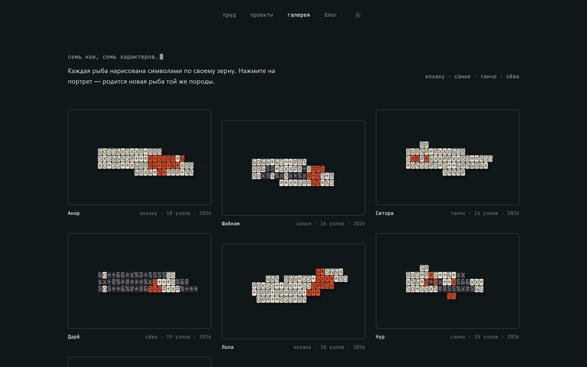

<div align="center">

# 🐟 Хавз — пруд, который можно покормить

**Личный сайт с прудом кои из символов. Рыбы плавают вокруг текста, обходят его стороной, тянутся к курсору и бегут к корму, когда кликаешь по воде. Чистый HTML, CSS и JavaScript: без сборки, без зависимостей, без единой картинки.**

[](https://github.com/boboevproject-rgb/havz/archive/refs/heads/main.zip)


<sub>Главная в тёмной и светлой теме. Каждая рыба — клетки и символы на canvas, нарисованные в реальном времени.</sub>

</div>

«Хавз» (ҳавз) по-таджикски — пруд.

---

## ✨ Что внутри

- **Живой пруд.** Семь кои четырёх пород (кохаку, санке, танчо, сёва) с собственной симуляцией: хребет из 15–20 узлов, рывки хвостом и скольжение, ныряние и всплытие, любопытство к курсору и испуг от резкого движения, обход текстовых блоков.
- **Кормление.** Клик по пустой воде бросает гранулу: она падает, приводняется, расходятся круги, ближайшие рыбы срываются к ней, открывают рот и кусают. Счётчик в углу показывает, сколько рыб и сколько корма на воде.
- **Сноски вместо резюме.** Названия проектов в тексте — кнопки: при наведении всплывает карточка с ролью, датами и описанием, клик открывает сайт проекта. На телефонах они превращаются в обычные ссылки.
- **Четыре страницы.** Пруд, лента проектов, галерея из семи портретов кои и блог-заглушка.
- **Две темы.** Тёплая тёмная вода по умолчанию и светлая по переключателю; выбор запоминается.
- **Бережно к ресурсам.** Пруд останавливается, когда вкладка скрыта или canvas не на экране, а при включённом в системе «уменьшении движения» показывает один неподвижный кадр.

---

## 🐟 Пруд


Код пруда лежит в [`js/pond.js`](js/pond.js) и состоит из трёх частей.

- **`World`** — симуляция. Для каждой рыбы на каждом шаге складываются «желания»: куда блуждать, как обойти край и текст, к какому корму плыть, стоит ли подойти к курсору или сбежать от него, как не слипнуться с соседями. Из суммы получается курс, поворот ограничен угловой скоростью, голова плывёт, хребет тянется следом.
- **`Renderer`** — отрисовка. Тело рыбы растрируется в сетку символов: каждая точка попадает в свою клетку, поэтому при любом повороте рыба выглядит цельной, как пиксель-арт. Рисунок породы задаётся при рождении рыбы и не мигает от кадра к кадру благодаря детерминированному хешу.
- **`Pond`** — движок страницы. Цикл с фиксированным шагом 60 Гц (не больше четырёх шагов за кадр), ResizeObserver, IntersectionObserver, события курсора и клика, замер текстовых блоков каждые 30 кадров.



<sub>Кормление: гранулы, круги на воде и рыбы, которые уже развернулись к еде. Счётчик в углу — 7 рыб, 2 гранулы.</sub>



<sub>Сноска: навёл на название — увидел карточку, кликнул — открыл проект.</sub>

### 📱 На телефоне

<div align="center">

</div>

Навигация сворачивается в «пилюлю», сноски становятся ссылками, счётчик прячется.

---

## 🧰 Проекты


Горизонтальная лента с привязкой прокрутки; колёсико мыши тоже листает её вбок. Обложки — CSS-градиенты, ни одной картинки. Карточки со ссылкой открывают сайт проекта.

| Проект | Что это | Стек |
|---|---|---|
| **Tomo24** | Телерадиология для клиник: кабинеты врача, клиники, менеджера и админа, DICOM, заключения PDF | TypeScript, Hono + tRPC, PostgreSQL |
| **MDB** | Medical Digital Bridge: ядро медицинской платформы и модули OKO24, Me | TypeScript, контракт модулей, Docker |
| **Ravand** | Контент-завод: сценарий → озвучка → монтаж → публикация с проверяющими на каждом этапе | Python, Docker, OpenRouter |
| **Guloro** | Цветы с доставкой по Худжанду: витрина, корзина, местные платёжки, админка, четыре языка | FastAPI, MongoDB, React |
| **Orzu 3D** | Маркетплейс 3D-печати с поиском на таджикском, русском и узбекском | FastAPI, SQLite FTS5, React |

---

## 🎨 Галерея



Семь портретов кои, нарисованных тем же движком в статике: Анор, Шабнам, Ситора, Дарё, Лола, Нур, Барф. У каждого своё зерно, поэтому рисунок повторяется от загрузки к загрузке. Нажмите на портрет — родится новая рыба той же породы.

---

## ✍️ Блог


Пока одна строка. Зато с мигающим курсором.

---

## ▶️ Запуск

Сайту нужен любой статический сервер: страницы подключают ES-модули, а их браузер не загружает с диска напрямую.

**Windows:** дважды щёлкните `start.bat`. Откроется http://localhost:8792.

**Любая система:**

```bash
git clone https://github.com/boboevproject-rgb/havz.git
cd havz
python -m http.server 8792
```

и откройте http://localhost:8792. Подойдёт и `npx serve`, и расширение Live Server в VS Code.

**Хостинг:** папка целиком выкладывается на GitHub Pages (Settings → Pages → ветка `main`, папка `/`), Netlify, Vercel или любой nginx. Сборка не нужна.

---

## 🛠 Сделать своим

| Что поменять | Где |
|---|---|
| Приветствие, текст о себе, ссылки на соцсети | [`index.html`](index.html), блок `.intro` |
| Цитата над текстом | [`index.html`](index.html), блок `.quote` |
| Карточки-сноски (название, роль, даты, описание, ссылка) | [`js/data.js`](js/data.js), объект `CITES` |
| Проекты в ленте и цвета их обложек | [`js/data.js`](js/data.js), массив `PROJECTS` |
| Имена и породы рыб в галерее | [`js/data.js`](js/data.js), массив `GALLERY` |
| Цвета страницы (`--bg`, `--fg`, `--accent`) | [`css/havz.css`](css/havz.css), блок `:root` |
| Цвета воды и рыб | [`js/pond.js`](js/pond.js), объект `THEMES` |
| Количество рыб | [`js/site.js`](js/site.js), параметр `koiCount` в `new Pond(...)` |
| Название и порт в `start.bat` | [`start.bat`](start.bat) |

Чтобы рыбы обходили ещё какой-нибудь блок, добавьте ему атрибут `data-avoid`. Чтобы клик по элементу не считался кормлением, добавьте `data-ignore`.

**Параметры адреса:** `?theme=light` или `?theme=dark` включают тему без переключателя, `?seed=7` делает расстановку и рисунок рыб повторяемыми (удобно для скриншотов).

---

## 📁 Структура

```
havz/
├── index.html        пруд
├── projects.html     лента проектов
├── gallery.html      портреты кои
├── blog.html         заглушка
├── css/havz.css      стили, темы, мобильная вёрстка
├── js/pond.js        симуляция, отрисовка, движок пруда
├── js/site.js        тема, навигация, сноски, лента
├── js/gallery.js     портреты
├── js/data.js        тексты карточек, проекты, галерея
├── favicon.svg
├── start.bat         локальный сервер на :8792
└── screenshots/      кадры для этого README
```

---

## 💡 Откуда идея

Идея пруда из символов, которого можно кормить, подсмотрена у Dao Ho и его сайта [daoho.dev](https://www.daoho.dev/). У оригинала нет лицензии, поэтому код Хавз написан с нуля: своя симуляция, своя растровая отрисовка, свои породы и свой рисунок. Для сравнения — оригинал:


<sub>daoho.dev, октябрь 2026. Скриншоты принадлежат автору сайта и приведены для сравнения.</sub>

---

## ⚖️ Лицензия

[MIT](LICENSE). Берите, меняйте, кормите рыб.
