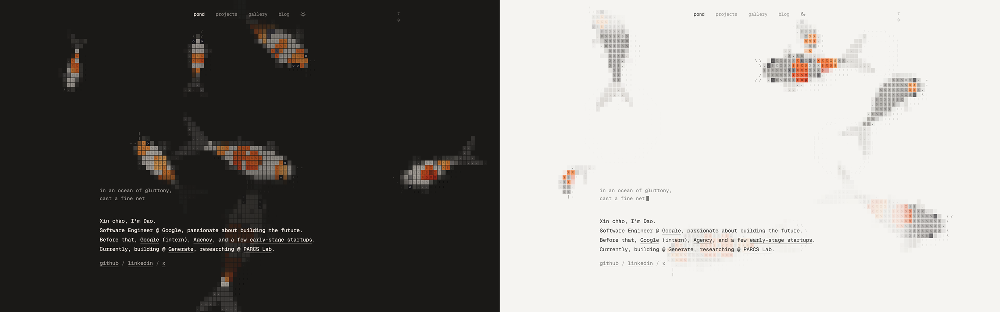
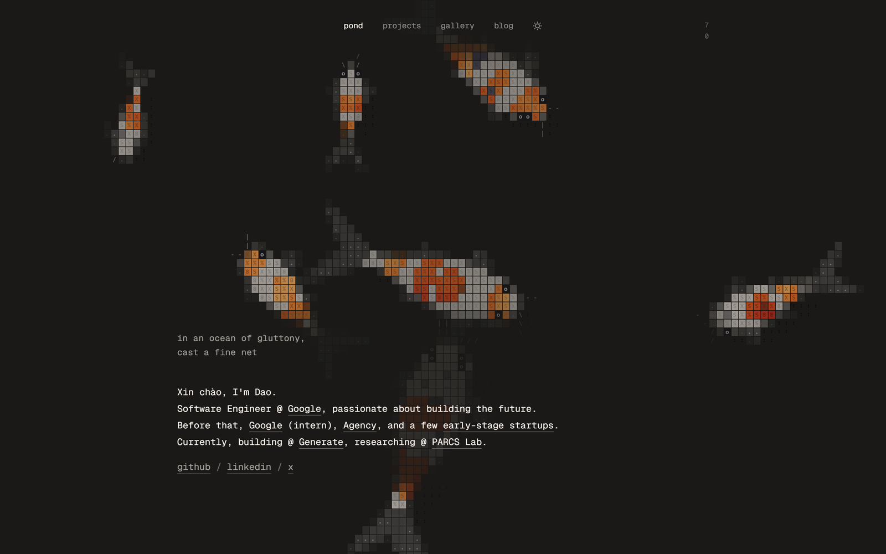
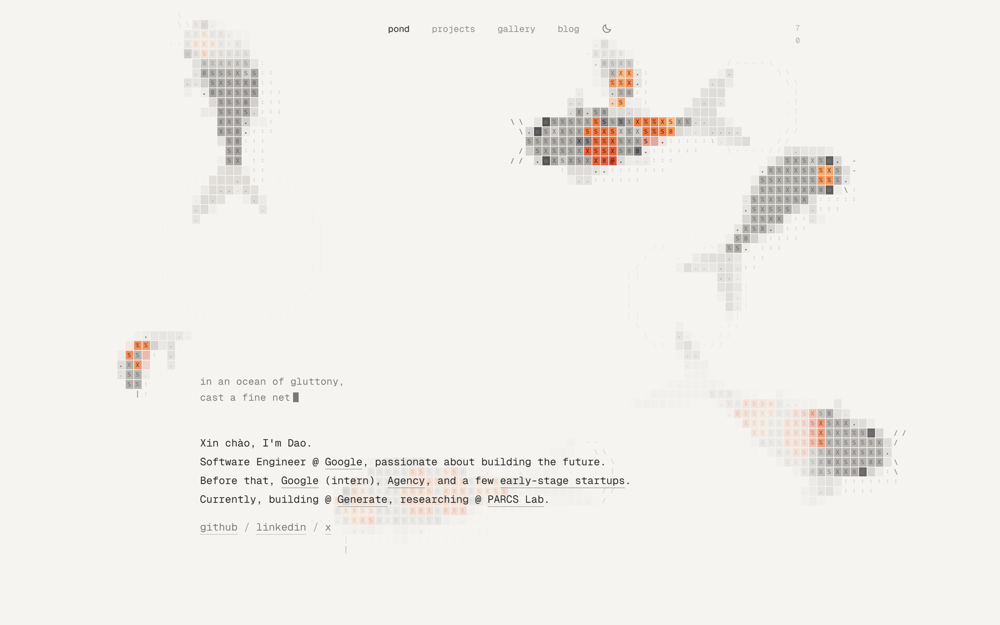
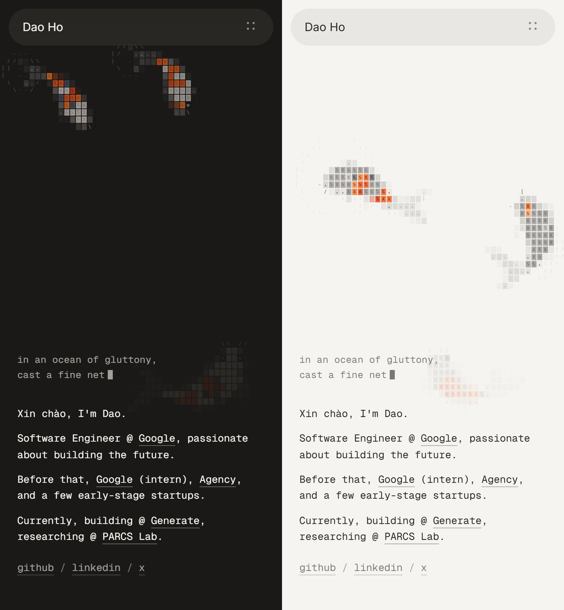
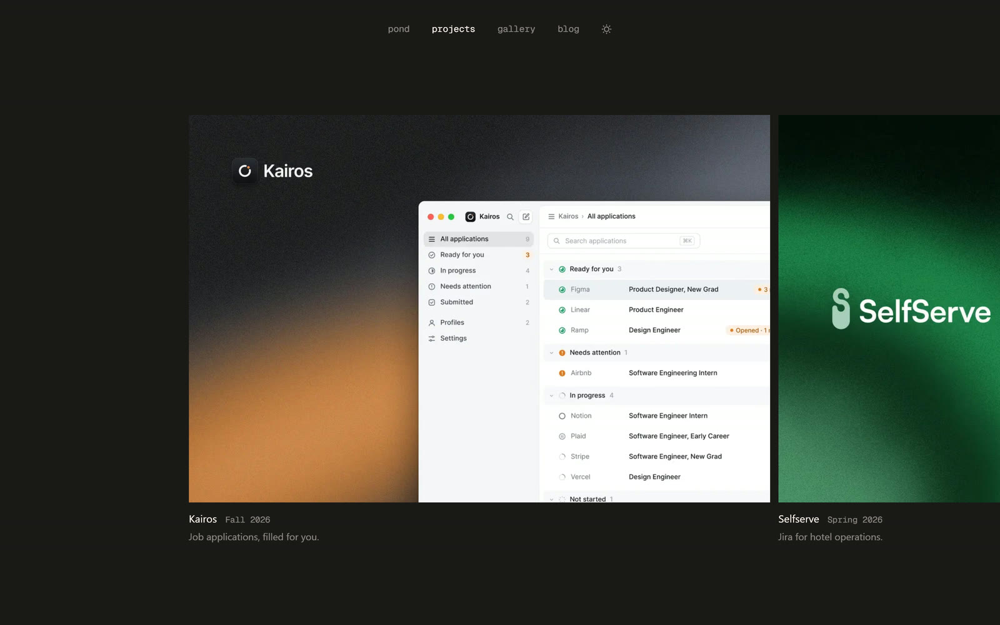
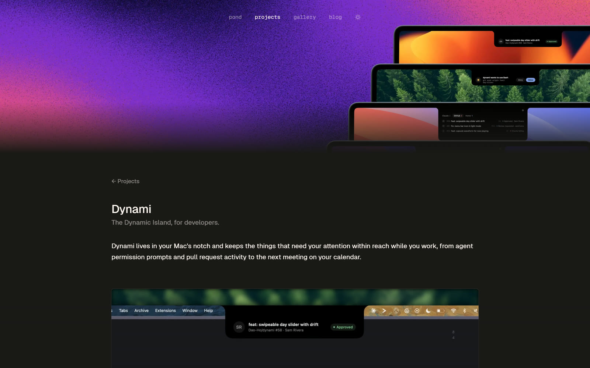
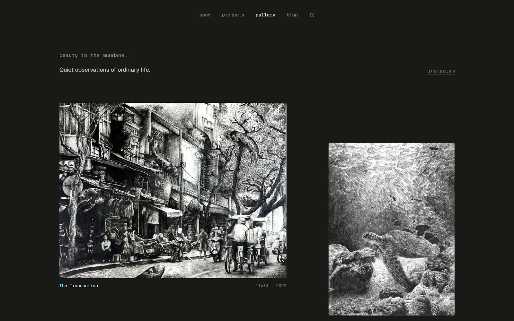
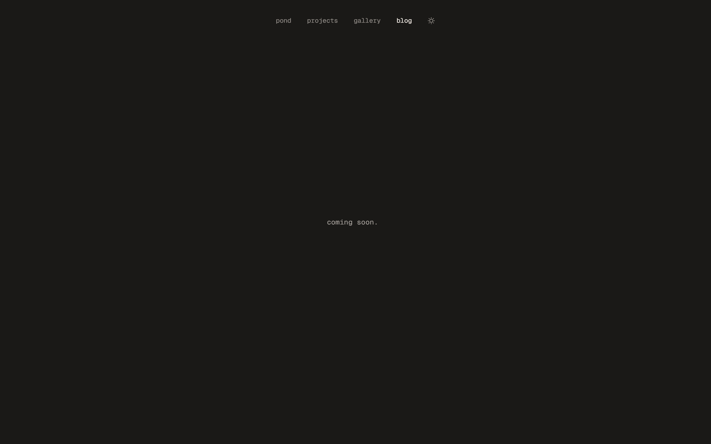

<div align="center">

# 🐟 daoho.dev — портфолио, которое можно покормить

**Обзор личного сайта Dao Ho: ASCII-пруд с карпами кои, которых можно кормить, пять продуктовых кейсов и семь премированных акварелей.**

[🇬🇧 English](README.md) · [🇷🇺 Русский](README.ru.md) · [🇹🇯 Тоҷикӣ](README.tg.md)

[](https://www.daoho.dev/)
[](https://github.com/Dao-Ho/portfolio)


[](https://github.com/boboevproject-rgb/daoho-portfolio-overview/archive/refs/heads/main.zip)



<sub>Главная в тёмной и светлой теме. Каждая рыба нарисована моноширинными символами на canvas.</sub>

</div>

---

## ✨ Чем этот сайт цепляет

- **Живой фон, который не видео.** Кои симулируются и отрисовываются в реальном времени на TypeScript, написанном вручную: ни игрового движка, ни WebGL-библиотек.
- **Рыб можно кормить.** Клик по пустой воде — падает гранула, ближайшие кои бросаются к ней и кусают. Ради этого на странице честно залипают.
- **Резюме в виде сносок.** Названия компаний во вступлении — цитаты: наведи, и увидишь должность, даты и строку описания; кликни, и откроется сайт компании.
- **За красотой — реальная работа.** Пять страниц-кейсов (приложение для «чёлки» Mac, панель для гостиничных операций, ветеринарная платформа, краудфандинг недвижимости, бот для заявок на работу) и галерея акварелей, взявших *Best in Show* в Балтиморском художественном музее.
- **Тихое мастерство в деталях.** Строчный моноширинный текст, тёплая двухцветная палитра, мигающий курсор и рыбы, которые вежливо обходят текст, а не плывут поверх него.

> Написано 26 октября 2026 года по живому сайту и его открытому исходному коду. Это независимый обзор, автор сайта к нему отношения не имеет.

---

## 👤 Кто такой Dao Ho

- Инженер-программист и студент Northeastern University (Бостон, США). Био на GitHub: *«Caffeine Driven Development»*.
- В январе 2027 выходит в **Google** работать над Shopping в Gemini. Летом 2026 стажировался в Google (инфраструктура цитирования и оценки для Gemini).
- До этого: **Agency** (2025, Member of Technical Staff, co-op; позже компанию купила Klaviyo), **DesignAI** (2024–2025) и **Paynalli Systems** (2024).
- Сейчас: **Chief of Software в Generate**, студенческой студии разработки Northeastern, и **ассистент-исследователь в PARCS Lab** (исследования LLM).
- В первом семестре университета вёл дискретную математику как ассистент в Khoury College — сам прошёл курс ещё в школе.
- Художник: семь акварелей, одна из них — *Best in Show* в Балтиморском художественном музее.

Ссылки: [GitHub](https://github.com/Dao-Ho) · [LinkedIn](https://www.linkedin.com/in/dao-ho/) · [X](https://x.com/daoho04) · [Instagram (живопись)](https://www.instagram.com/artdaoho/)

---

## 🐟 Пруд — главная страница



<sub>Правый верхний угол: крошечный счётчик показывает 7 кои и 0 гранул на воде.</sub>

**Что видно.** Один экран, без прокрутки. Canvas заполняет окно, по нему дрейфуют кои трёх пород (кохаку, санке, танчо). Сверху текст: двустрочная цитата с мигающим курсором, *«Xin chào, I'm Dao.»* («xin chào» — «привет» по-вьетнамски), три предложения о работе и три ссылки на соцсети.

**Что делают рыбы.** У каждой кои «позвоночник» из 20 узлов. Она плывёт рывками ударов хвоста и затем скользит, ныряет и всплывает, пошевеливает грудными плавниками, когда зависает, тянется к курсору, пугается и убегает при резком движении указателя и обходит текстовые блоки, бледнея под ними.

**Кормление.** Клик по пустой воде. Гранула мгновение падает, приводняется и дрейфует. Ближайшие кои бросаются к ней, открывают рот на подходе, вспышка отмечает укус. Клики по ссылкам, кнопкам и выделенному тексту игнорируются. Каждое кормление логируется событием `koi_pond_fed`.

**Доступность.** Если в ОС включено *уменьшение анимации*, пруд даёт рыбам разойтись и замирает на одном кадре.



<sub>Светлая тема. Переключает иконка луны в навигации; выбор запоминается в localStorage.</sub>

### 📱 На телефоне

<div align="center">

</div>

Навигация сворачивается в плавающую «пилюлю». Сноски становятся обычными ссылками: карточкам при наведении нужен указатель.

---

## 🧰 Проекты



Горизонтальная лента со слайдовыми переходами. Кольцо плиток прокручивается при входе, чтобы было понятно: «крути, чтобы вращать». У каждого проекта своя страница: слоган, описание, демо-видео или постер, широкая обложка, карточка 1200×630 для превью ссылок, история в абзацах с клипами между ними и галереи скриншотов с подписями.

| Проект | Что это | Стек | Когда |
|---|---|---|---|
| **Kairos** | «Заявки на работу, заполненные за вас». Отправь ссылку на вакансию, бот заполнит анкету и оставит только поля, которые требуют тебя | в работе | Осень 2026 |
| **Selfserve** | «Jira для гостиничных операций». Панель самообслуживания для персонала отеля: задачи, заявки, ежедневная рутина (проект Generate) | Next.js, TypeScript, Go | Весна 2026 |
| **Dynami** | «Dynamic Island для разработчиков». Приложение для «чёлки» Mac: запросы разрешений от агентов, активность по pull request'ам и календарь, видны одним взглядом, не отвлекаясь от работы | Swift, SwiftUI, GitHub API | Весна 2026 |
| **Vetruly** | Проверенная ветеринарная помощь для выздоравливающих и сложных пациентов. Вёл команду из пяти человек от идеи до продакшена | Next.js, TypeScript, PostgreSQL | Весна 2025 |
| **Three Stones** | Краудфандинг недвижимости для обычных инвесторов. Делал вход, главный экран и поиск в команде из пяти | React Native, Go, Supabase | Осень 2024 |



<sub>Страница проекта: обложка, слоган, описание, затем история со скриншотами и клипами.</sub>

---

## 🎨 Галерея



Заголовок: *«beauty in the mundane.»* («красота в обыденном») и *«Quiet observations of ordinary life.»* («тихие наблюдения за обычной жизнью»). Семь работ развешаны **«салонной» развеской на стене из 12 колонок**: у каждой своя ширина в колонках и свой вертикальный сдвиг, поэтому размеры и промежутки варьируются, как на настоящей выставке. Клик открывает лайтбокс, стрелки листают, Escape закрывает.

| Работа | Размер (дюймы) | Год | Награды |
|---|---|---|---|
| The Transaction | 11×14 | 2023 | Best in Show, James Laubheimer's Award · премия Балтиморского акварельного общества за мастерство в водных техниках · Schwab Lipowitz & Solter, 1-е место |
| Haku | 8.5×11 | 2023 | |
| Fish Market | 10×12 | 2023 | Выставлялась в Балтиморском художественном музее |
| Holding On | 10×8 | 2022 | |
| Duality | 22×17 | 2022 | |
| Held | | 2022 | |
| Engulfed | | 2022 | |

---

## ✍️ Блог



Одна строка *«coming soon.»* («скоро») с тем же мигающим курсором.

---

## 🏗️ Как сделано

| Слой | Что используется |
|---|---|
| Фреймворк | Next.js 14 (App Router), React 18, TypeScript 5 |
| Стили | Tailwind CSS 3, `tailwindcss-animate`, `tailwind-scrollbar-hide`, утилиты в стиле shadcn (`cva`, `clsx`, `tailwind-merge`), Radix UI (slot, switch), Material Tailwind, иконки Phosphor и Lucide |
| Анимация | Framer Motion + Motion для переходов интерфейса, GSAP со ScrollTrigger для скролл-эффектов, Swiper и `react-fast-marquee` для лент |
| Пруд | Написан вручную: `world.ts` симулирует кои, гранулы, укусы, круги на воде и зоны обхода; `renderer.ts` рисует символы на 2D-canvas; `koi-pond.tsx` крутит цикл с фиксированным шагом 60 Гц (не больше 4 шагов за кадр), каждые 30 кадров заново измеряет текстовые блоки, останавливается вне экрана и уважает `prefers-reduced-motion` |
| Шрифты | Geist Sans и Geist Mono лежат локально; Inter, Bebas Neue, Libre Baskerville, Roboto, Roboto Condensed, Oswald, Source Sans 3, Playfair Display через `next/font` |
| Изображения | `next/image` с выдачей AVIF/WebP и кэшем на 31 день; рецепт `just webp` конвертирует PNG-экспорты из Figma через `sharp` |
| Аналитика | PostHog (события + запись сессий) через прокси `/ingest/*`, чтобы блокировщики рекламы не резали события; Vercel Analytics |
| Данные | API-роут забирает календарь контрибуций GitHub через GraphQL и кэширует его в Redis на час |
| Инструменты | ESLint + Prettier, `justfile` (`install / dev / build / lint / format / typecheck / check / fix / clean / webp`); CI перед сборкой гоняет `just check` |
| Хостинг | Vercel |

**Токены дизайна.** Светлая тема: фон `#f5f4f1`, текст `#262523`. Тёмная: фон `#1a1917`, текст `#fff7f0`. Приглушённый текст — тот же цвет с прозрачностью 50–64 % через `color-mix`. Текст 13–15 px строчный моноширинный; колонка на десктопе стоит на 20 vw.

---

## ⬇️ Скачать и запустить у себя

**Этот обзор** (текст + скриншоты):

```bash
git clone https://github.com/boboevproject-rgb/daoho-portfolio-overview.git
```

или просто [ZIP-архив](https://github.com/boboevproject-rgb/daoho-portfolio-overview/archive/refs/heads/main.zip).

**Оригинальный сайт**, чтобы поднять его на своей машине (нужен Node 18.17+):

```bash
git clone https://github.com/Dao-Ho/portfolio.git
cd portfolio
npm ci
npm run dev
```

Дальше откройте http://localhost:3000. Пруд, проекты и галерея работают вообще без ключей. Три необязательные переменные окружения в `.env.local` включают дополнительное: `NEXT_PUBLIC_POSTHOG_PROJECT_TOKEN` (аналитика), `GITHUB_TOKEN` и `REDIS_URL` (график контрибуций). Имейте в виду: репозиторий весит около **410 МБ**, потому что хранит оригинальные PNG-работы и вложенный пак `Design-Portfolio.git`. Если стоит `just`, доступны `just dev`, `just check` и `just webp in.png out.webp`.

---

## 📊 Факты о репозитории

| | |
|---|---|
| Репозиторий | [github.com/Dao-Ho/portfolio](https://github.com/Dao-Ho/portfolio) (пакет `port-web` 0.1.0) |
| Язык | TypeScript |
| Создан | 22 ноября 2023 |
| Коммитов | около 171 |
| Звёзды / форки | 24 / 1 (октябрь 2026) |
| Темы | art, gallery, gallery-viewer, portfolio, portfolio-website, website |
| Активность | очень живой в октябре 2026: ежедневные pull request'ы #59–#73 добавили страницы проектов, цитату на пруду, PostHog, оптимизацию изображений и анимацию переключателя темы |
| README | одна строка: «Hey! Get to know me @ daoho.dev :)» |

---

## ⚖️ Лицензия и авторство

- В оригинальном репозитории **нет файла лицензии**. По умолчанию на GitHub это значит, что все права остаются у автора: код можно читать, изучать и запускать локально, но нельзя выкладывать как свой сайт без разрешения.
- Все работы, скриншоты и тексты, показанные здесь, принадлежат **Dao Ho** и приведены в целях обзора со ссылками на источник.
- Скриншоты сняты 26 октября 2026 года в headless Chrome при 1440×900 и 390×844.

---

<div align="center">

**Сайт:** https://www.daoho.dev/ · **Исходники:** https://github.com/Dao-Ho/portfolio

[Generate](https://generatenu.com/) · [PARCS Lab](https://parcslab.fyi/) · [Agency](https://www.agency.inc/) · [DesignAI](https://www.designai.co/) · [Paynalli](https://paynalli.com/)

</div>
